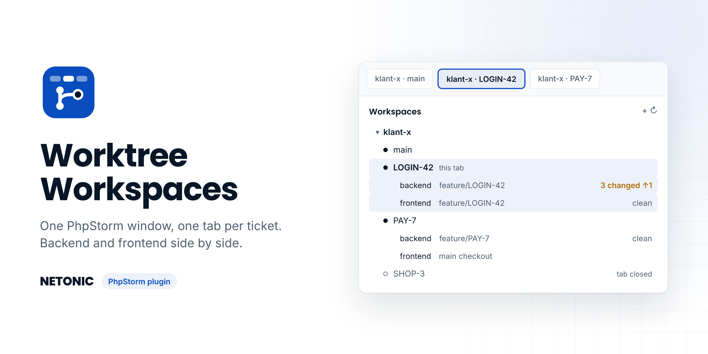

# Worktree Workspaces (PhpStorm plugin)



A PhpStorm plugin by [Netonic](https://netonic.nl). One PhpStorm window, one tab per ticket, backend + frontend together.

```
~/PhpstormProjects/klant-x/        workspace
  .workspace.json                  repos, branch pattern, files to copy
  main/                            tab "klant-x · main"     (real clones)
    backend/  frontend/
  LOGIN-42/                        tab "klant-x · LOGIN-42" (git worktrees)
    backend/  frontend/
  PAY-7/                           tab "klant-x · PAY-7"
    backend/                       frontend is attached from main/
```

## Install

1. PhpStorm › Settings › Plugins › ⚙ › **Install Plugin from Disk…** › [`dist/worktree-workspaces-0.1.0.zip`](dist/worktree-workspaces-0.1.0.zip) › restart.
2. macOS: *System Settings › Desktop & Dock › Prefer tabs when opening documents* → **Always**.
   Ticket windows then open as tabs of one window and stay that way after a restart.
   (The plugin also merges new ticket windows into tabs itself; toggle it under the panel's ⚙.)
3. The first time a ticket opens, PhpStorm may ask to trust it: tick **Trust projects in `klant-x`**.

Built against PhpStorm 2026.2.3 (build 262); needs 2026.2 or newer.

## Use

| Where | What |
| --- | --- |
| **Workspaces** tool window (left) | Workspaces › tickets › repos with branch, changed files (`3 changed`) and unpushed commits (`↑1`). Double-click opens or focuses a ticket. Right-click for more. |
| Toolbar, next to the project name | `klant-x / LOGIN-42 ▾`: searchable list of every ticket, plus New Ticket / New Workspace. |
| Tools › Workspaces, or Find Action | Switch Ticket, New Ticket, Finish Ticket, New Workspace, Add Repo. Assign a shortcut to **Switch Ticket** in Settings › Keymap. |

**New workspace** — name, location, and per repo either a git URL (cloned) or an existing checkout
(moved into `main/`, e.g. `~/PhpstormProjects/billebly-backend` → `billebly/main/backend`).
Open projects in those folders are closed first. Afterwards `main` opens as a tab.

**New ticket** — type the key (`LOGIN-42`); the branch comes from the pattern (`feature/LOGIN-42`) and can be
edited. Tick the repos it touches. Per repo the plugin fetches the base branch, then:

- branch exists locally → worktree on it
- branch exists on origin (a colleague pushed it) → worktree tracking it
- otherwise → new branch from `origin/<base>`

Then `.env`, `.env.local`, `auth.json`, `vendor/` and `node_modules/` are copied from `main/<repo>` with
APFS clones (`cp -c`: instant, no extra disk space). Run `composer install` / `npm ci` only when lock files differ.
`.idea` settings (PHP interpreter, code style, run configs, data sources) are copied from `main/.idea`, never
`workspace.xml`.

**Ticket needs another repo later** — right-click the grey *main checkout* row › *Add frontend to PAY-7*.

**Finish ticket** — lists uncommitted changes and commits that are on no remote. Closes the tab, runs
`git worktree remove` per repo and deletes the folder. Branches are kept unless fully merged (optional `git branch -d`).
Uncommitted work is only discarded when you tick *Discard uncommitted changes*. A folder that still holds other
files (notes, scripts) is never deleted.

## `.workspace.json`

```json
{
  "name": "klant-x",
  "branchPattern": "feature/{ticket}",
  "repos": {
    "backend":  { "url": "git@github.com:org/klant-x-backend.git", "baseBranch": "develop",
                  "copy": [".env", ".env.local", "auth.json", "vendor", "node_modules"] },
    "frontend": { "baseBranch": "main", "copy": [".env", "node_modules"] }
  }
}
```

Edit it from the panel (⚙ › Edit .workspace.json). `baseBranch` is detected from the remote when a repo is added.

## Not in v1

Jira picker · setup commands after create (`composer install`, migrations, `herd link`) · Docker ports per ticket ·
Windows/Linux tab behaviour.

## Build

Offline, against your installed PhpStorm (needs JDK 25, e.g. `brew install openjdk`):

```
JAVA_HOME=$(/usr/libexec/java_home -v 25) ./build.sh
# → build/distributions/worktree-workspaces-0.1.0.zip
```

`build.sh` also runs the core tests (real git repos in a temp folder). After a release build, copy the zip into
`dist/`. `tools/api-check.sh` flags internal, experimental or deprecated PhpStorm APIs.

## Code map

- `core/` — plain Java, no IDE dependencies: config, `git worktree` operations, APFS copy, `.idea` preparation, finish checks.
- `ide/` — services (settings, background scan of all workspaces), opening tickets as tabs, keeping attached repos
  and Git roots in sync, tool window, toolbar switcher, dialogs, actions.
- `src/main/resources/META-INF/plugin.xml` — registrations.

## Docs

- [`CLAUDE.md`](CLAUDE.md) — context for working on the code (architecture, rules, status, backlog).
- [`docs/PLAN.md`](docs/PLAN.md) — the v1 plan, mock-ups and decisions.
- [`docs/PERFORMANCE.md`](docs/PERFORMANCE.md) — performance, and running Claude in several tickets at once.
