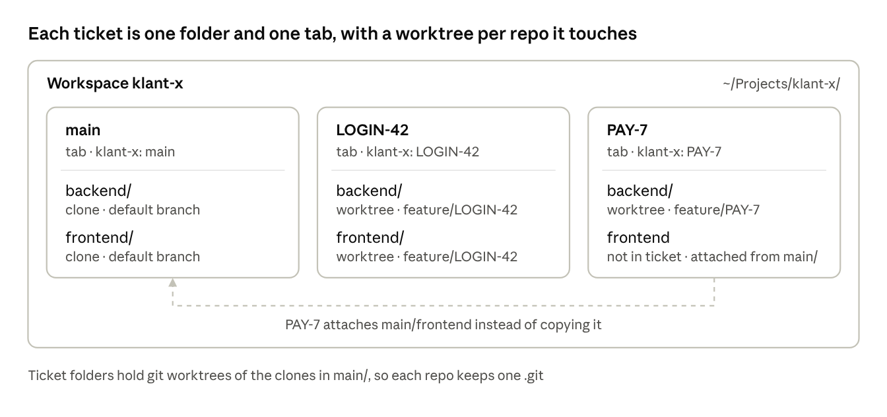
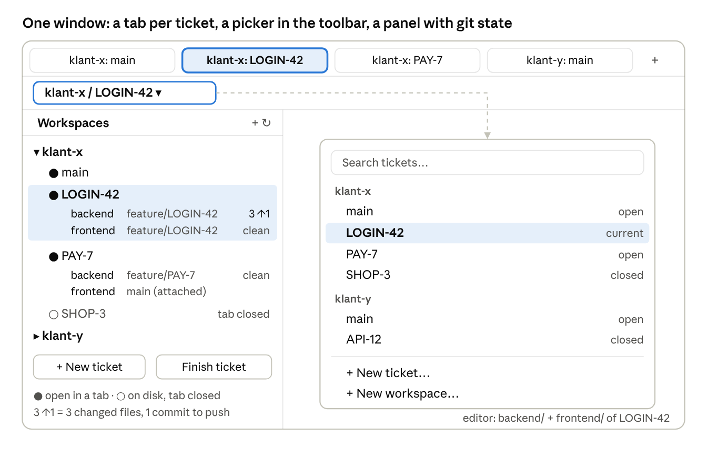
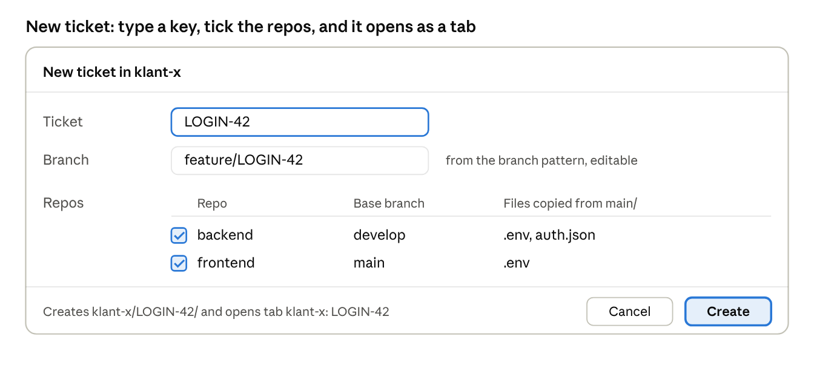

# Worktree Workspaces — v1 plan

Plan agreed on 13 Oct 2026, before building. Where the build differs from the plan, it says so below; `CLAUDE.md` describes the code as it is.

## Problem

Working on several tickets across a backend and a frontend repo means juggling many PhpStorm windows and scattered
worktree folders.

- PhpStorm 2026.1+ has native worktrees (Git tool window › Worktrees tab), but only for single-repo projects, and every
  worktree opens as its own project ([PhpStorm help](https://www.jetbrains.com/help/phpstorm/use-git-worktrees.html)).
- So 2 repos × 3 tickets = 6 separate projects, in folders wherever they were created, and nothing tells you which
  backend worktree belongs with which frontend worktree.
- JetBrains' own multi-project *Workspaces* is an IntelliJ IDEA plugin, and its docs don't cover PhpStorm
  ([JetBrains blog](https://blog.jetbrains.com/idea/2025/03/ide-workspaces-development-challenges-and-plans/)).

**Goal:** one PhpStorm window, one tab per ticket that holds both repos, and one panel that shows every workspace,
ticket and its git state.

## Concept

A **workspace** is one client project (backend + frontend), a **ticket** is a branch in one or more of its repos, and
every ticket gets its own tab.



`main` is the default ticket and holds the real clones; LOGIN-42 touches both repos, PAY-7 only the backend.

## Folder layout

Every workspace is one folder, and every ticket is a sub-folder that is itself the PhpStorm project behind its tab.

```
~/PhpstormProjects/klant-x/         workspace
  .workspace.json                   repos, branch pattern, files to copy
  main/                             tab "klant-x · main"
    .idea/
    backend/                        real clone
    frontend/                       real clone
  LOGIN-42/                         tab "klant-x · LOGIN-42"
    .idea/                          copied from main/.idea
    backend/                        git worktree, branch feature/LOGIN-42
    frontend/                       git worktree, branch feature/LOGIN-42
  PAY-7/                            tab "klant-x · PAY-7"
    .idea/
    backend/                        git worktree, branch feature/PAY-7
                                    (frontend: main/frontend attached as extra root)
```

- **Works without the plugin.** Open any ticket folder in PhpStorm and both repos show up, with multi-root Git.
- **One `.git` per repo.** `main/` holds the real clones; ticket folders hold worktrees of them.
- **Untouched repos aren't copied.** If a ticket skips a repo (frontend in PAY-7), the tab attaches `main/frontend`
  as an extra content root.
- **One-time migration.** Existing checkouts move into `<workspace>/main/`; adopting a repo does the move and runs
  `git worktree repair`.

The workspace config is a small file next to the tickets:

```json
{
  "name": "klant-x",
  "branchPattern": "feature/{ticket}",
  "repos": {
    "backend":  { "baseBranch": "develop", "copy": [".env", ".env.local", "auth.json", "vendor", "node_modules"] },
    "frontend": { "baseBranch": "main",    "copy": [".env", "node_modules"] }
  }
}
```

## UI

Three pieces sit on top of normal PhpStorm: a window tab per ticket, a picker in the toolbar, and a *Workspaces*
side panel.



- **Tab bar:** one macOS window tab per open ticket, named `workspace · ticket` (the mock-up shows a colon; the build
  uses `·`).
- **Toolbar picker:** shows where you are; click for a searchable list grouped by workspace, plus *New ticket* and
  *New workspace*.
- **Workspaces panel:** workspaces › tickets › repos with branch and git state. Double-click switches; right-click for
  *Finish ticket* and *Reveal in Finder*.



The dialog only needs the key; branch, base branch and files to copy come from `.workspace.json`.

## Key flows

**Set up a workspace** (once per client)

1. Side panel › **+** › *New workspace*: pick a name and folder, e.g. `~/PhpstormProjects/klant-x`.
2. Add repos: clone from a URL into `main/<repo>`, or adopt an existing checkout (moved into `main/`).
3. Per repo, the base branch is detected from the remote; files to copy default to `.env`, `.env.local`,
   `auth.json`, `vendor`, `node_modules`.
4. The plugin writes `.workspace.json` and opens `main` as the first tab.

**Start a ticket**

1. Toolbar picker › *New ticket*.
2. Type the key, e.g. `LOGIN-42`; the branch fills in from the pattern (`feature/LOGIN-42`) and stays editable.
3. Tick the repos it touches (all ticked by default).
4. Per ticked repo: fetch the base branch, then `git worktree add <workspace>/LOGIN-42/<repo>` — on the existing local
   branch, tracking `origin/<branch>` if a colleague pushed it, or as a new branch from `origin/<base>`. Then copy the
   listed files from `main/<repo>` (APFS clone).
5. Copy the shared parts of `main/.idea` (PHP interpreter, code style, run configs) and attach unticked repos from
   `main/`.
6. Open it as a new tab named `klant-x · LOGIN-42`.

**Switch**

- Click the tab, pick the ticket in the toolbar picker, or double-click it in the side panel.
- Already open → that tab is focused. Not open → it opens as a new tab.

**Close vs. finish a ticket**

- *Close tab* only closes the project; worktrees stay on disk and the ticket stays in the panel.
- *Finish ticket* checks each repo for uncommitted or unpushed work and warns, then runs `git worktree remove` per
  repo and deletes the ticket folder. Branches are kept, with an option to delete them when merged. A folder that
  still holds other files is never deleted.

## v1 scope

v1 is the smallest thing that replaces the 20 windows: workspaces, tickets as tabs, a picker, a panel, and safe
create/finish.

**In v1 (built in 0.1.0)**

- [x] `.workspace.json` + *New workspace* (clone or adopt repos into `main/`)
- [x] *New ticket*: branch + worktree per ticked repo, copy listed files, copy shared `.idea` settings
- [x] One tab per ticket (macOS window tabs), focus if already open
- [x] Toolbar picker: current `workspace / ticket`, search, *New ticket*
- [x] Side panel: workspaces › tickets › repos, with branch, changed files and commits to push
- [x] Ticket folders found on disk show up automatically (rescan)
- [x] *Finish ticket* with uncommitted/unpushed checks
- [x] Extra (not in the plan): *Add repo to ticket* on an attached repo

**Not in v1**

- Jira picker
- Setup commands after create (`composer install`, `npm ci`, migrations, `herd link`)
- Docker / port handling per ticket
- Windows and Linux tab behaviour (macOS first)

## Later ideas (v2+)

These build on the same model without changing it.

- **Jira picker:** pick from your assigned issues; key, title and branch fill in, and the tab shows the title.
- **Setup commands per repo:** run `composer install`, `npm ci`, `php artisan migrate` after create, with progress.
- **Per-ticket database / Docker:** own `DB_DATABASE`, compose project name and ports, so two tickets can run side by
  side.
- **Ticket notes and status** in the panel (e.g. *waiting for review*), plus a link to the open PR.
- **Auto-tidy:** suggest finishing tickets whose branches are merged, and closing tabs idle for a few days.

## Technical notes (as built)

The plan proposed Kotlin + the IntelliJ Platform Gradle Plugin and Git4Idea's command API. The build uses plain Java
compiled offline against the installed PhpStorm, and the git CLI, so the core can be unit-tested without an IDE.

| Piece | Approach |
| --- | --- |
| Stack | Java (`--release 21`), compiled with JDK 25 against PhpStorm 2026.2.3's own jars (`build.sh`); `since-build` 262 |
| Tab per ticket | Each ticket folder is a normal project, opened in a new frame (`ProjectUtil.openOrImport(path, null, true)`); on macOS the plugin then runs *Merge All Project Windows*. Already open → focus that frame |
| Both repos in one tab | Ticket folder is the project root, so both repo folders sit inside it; `.idea/vcs.xml` maps each repo as a Git root. A repo from `main/` is attached as a content root (written into the `.iml` before opening, and kept in sync by a startup activity) |
| Worktree commands | `git worktree add / remove / prune` via the git CLI (path and environment from PhpStorm's Git settings), `GIT_TERMINAL_PROMPT=0`, `GIT_OPTIONAL_LOCKS=0`, in a background task with progress |
| Git status | `git status --porcelain=v2 --branch` + `git rev-list --count HEAD --not --remotes` per repo, scanned in the background |
| Side panel | `ToolWindowFactory` with a tree, fed by one application-level service so every tab shows the same data |
| Toolbar picker | `ExpandableComboAction` in the new UI's `MainToolbarLeft` group, after the project widget, opening a speed-search list |
| Config | `.workspace.json` per workspace (own tiny JSON reader); app-level `PersistentStateComponent` remembers workspace paths |

**Caveats**

- macOS forgets merged tabs on restart unless *System Settings › Desktop & Dock › Prefer tabs when opening documents*
  is set to *Always* ([PhpStorm help](https://www.jetbrains.com/help/phpstorm/opening-multiple-projects.html)).
- Never copy `.idea/workspace.xml` between tickets: a shared `ProjectId` makes PhpStorm treat two folders as one
  project ([PhpStorm help](https://www.jetbrains.com/help/phpstorm/use-git-worktrees.html)).
- Each open tab is a full project with its own indexes and memory; the win is order, not RAM. See `PERFORMANCE.md`.
- A fresh worktree has no `vendor/` or `node_modules/`, so they are cloned from `main/` (see Decisions).

## Decisions

- [x] **`vendor/` and `node_modules/` are reused:** APFS clone from `main/` (`cp -c`), together with `.env`,
  `.env.local` and `auth.json`. Clones, not symlinks, so `composer install` in one ticket can't break another.
- [x] **Untouched repo:** attached from `main/` and editable; the panel shows it as *main checkout*. Right-click it to
  give the ticket its own worktree later.
- [x] **Ticket folder name:** key only (`LOGIN-42`); the branch comes from `feature/{ticket}` and is editable.
- [x] **Base branch:** from `.workspace.json` (detected from the remote), overridable per ticket in the dialog.
- [x] **`main` tab:** pinned first, can't be finished.
- [x] **Name / vendor:** *Worktree Workspaces* by Netonic; plugin id `nl.netonic.worktree-workspaces`; tabs are named
  `klant-x · LOGIN-42`.
- [ ] **Shortcut** for Switch Ticket: unbound for now (Settings › Keymap › Switch Ticket).

## Sources

- [PhpStorm help: Use Git worktrees](https://www.jetbrains.com/help/phpstorm/use-git-worktrees.html)
- [PhpStorm help: Open multiple projects](https://www.jetbrains.com/help/phpstorm/opening-multiple-projects.html)
- [IntelliJ IDEA help: Workspaces](https://www.jetbrains.com/help/idea/workspaces.html)
- [JetBrains blog: IDE workspaces, challenges and plans](https://blog.jetbrains.com/idea/2025/03/ide-workspaces-development-challenges-and-plans/)
